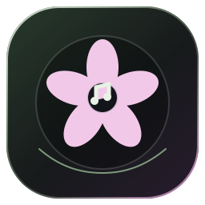
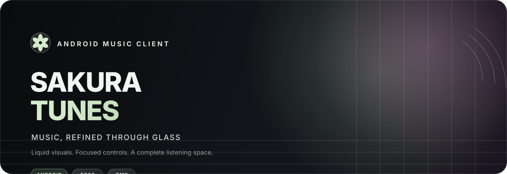
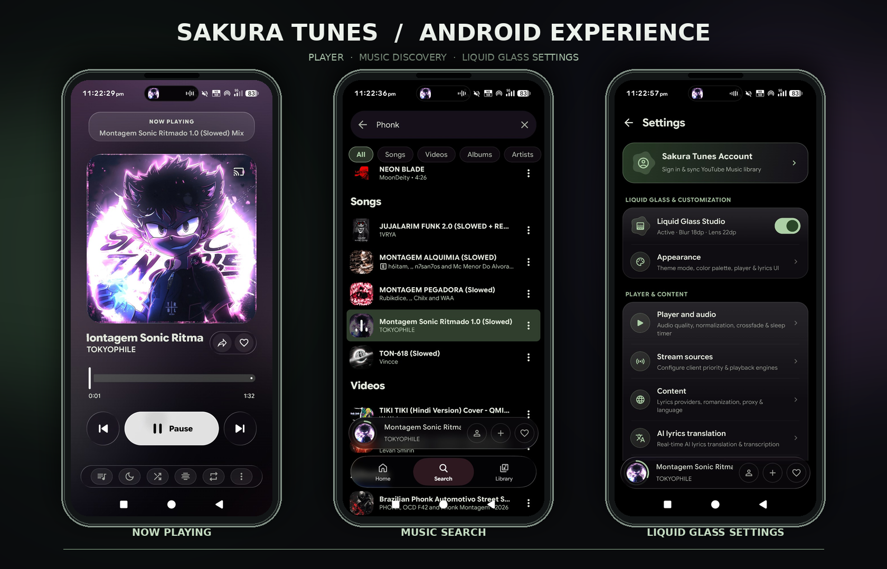
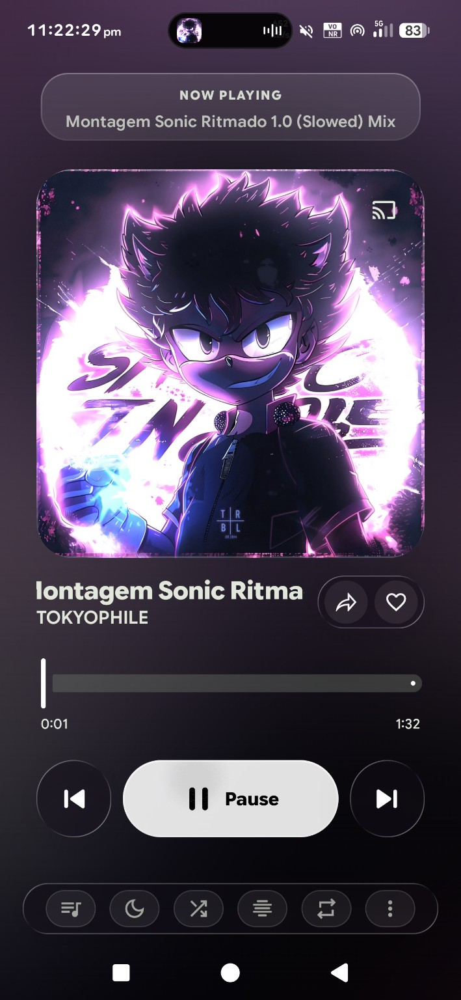
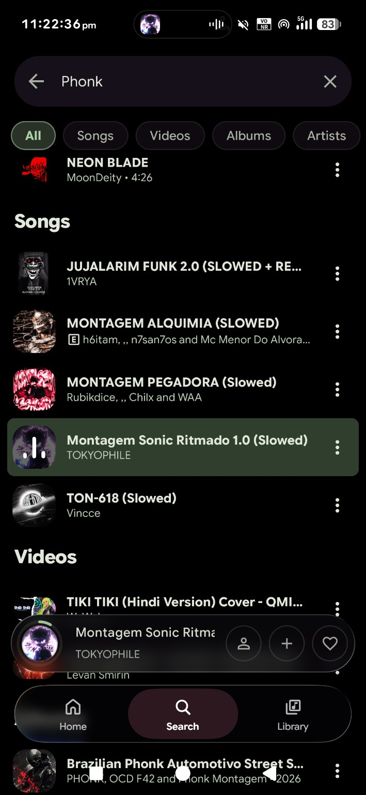
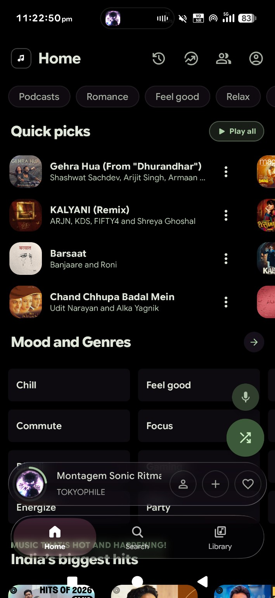
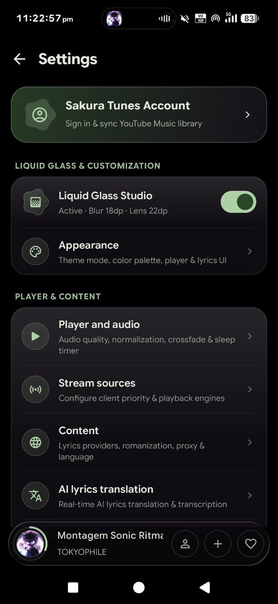
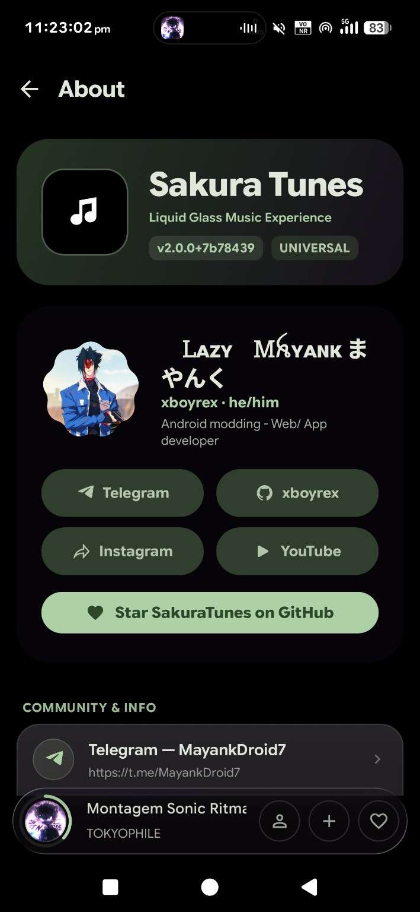

# Sakura Tunes

**A glass-first music experience for Android.**

  <a href="https://github.com/xboyrex/SakuraTunes/releases/latest"><strong>Download latest build</strong></a>
  &nbsp; · &nbsp;
  <a href="https://github.com/xboyrex/SakuraTunes/releases">Release history</a>
  &nbsp; · &nbsp;
  <a href="https://github.com/xboyrex/SakuraTunes/issues">Report an issue</a>
  &nbsp; · &nbsp;
  <a href="https://t.me/MayankDroid7">Community</a>

---

## Product preview

Device-frame showcase composed from the supplied application screenshots.

View all application screens

  
  
  
  
  

## Navigation

- [Overview](#overview)
- [Feature set](#feature-set)
- [Design system](#design-system)
- [Downloads and latest release](#downloads-and-latest-release)
- [Build from source](#build-from-source)
- [Project structure](#project-structure)
- [Release automation](#release-automation)
- [Roadmap and feedback](#roadmap-and-feedback)
- [Legal and policies](#legal-and-policies)
- [Developer](#developer)

## Overview

**Sakura Tunes** (`com.sakuratunes.music`) is an open-source Android music client built around a custom Liquid Glass interface and a flexible playback pipeline. The project combines music discovery, synchronized lyrics, playback controls, personalization, external integrations, and automated release builds in one application.

The visual language uses deep AMOLED surfaces, translucent glass layers, restrained Sakura accents, rounded typography, and compact controls. The interface keeps artwork and playback actions prominent without turning every screen into a panel of decoration.

| Project detail | Current configuration |
| :--- | :--- |
| Application ID | `com.sakuratunes.music` |
| Minimum Android version | Android 8.0 / API 26 |
| Target SDK | 36 |
| Compile SDK | 37 |
| Java toolchain | 21 |
| Primary UI stack | Kotlin, Jetpack Compose, Material 3 |
| Playback stack | AndroidX Media3 |
| License | GPL-3.0 |

## Feature set

Each feature group has its own vector identity. The icons are editable SVG assets maintained in `assets/icons/`.

| Feature | Capabilities |
| :--- | :--- |
|  **Liquid Glass Studio** | Hardware-accelerated backdrop treatments, blur, refractive lens effects, chromatic dispersion, rim highlights, touch feedback, and quality presets. |
|  **Playback and audio** | Gapless playback, silence skipping, audio normalization, pitch and tempo adjustment, crossfade, and equalizer support through AndroidX Media3. |
|  **Synchronized lyrics** | Line-level and word-level lyrics with provider fallback, translations, and romanization support across multiple writing systems. |
|  **Listen Together** | Shared listening sessions with synchronized playback state and host or guest controls. |
|  **Music recognition** | ShazamKit-powered recognition entry points, subject to platform and service availability. |
|  **Scrobbling and presence** | Last.fm scrobbling and Discord Rich Presence integration. |
|  **Storage analyzer** | Visibility into audio cache, artwork cache, and local storage usage, with cache cleanup controls. |
|  **Android Auto and widgets** | Media browsing and playback integration through Android media-session and browser-service APIs, plus glanceable home-screen widgets. |
|  **Google Cast** | Casting support in the GMS build. This integration is not included in the FOSS or Izzy variants. |
|  **Appearance and themes** | Sakura-inspired palettes, dark surfaces, dynamic artwork colors, typography options, and customizable player presentation. |
|  **Build and update pipeline** | Automated Android builds, release assets, versioned changelog extraction, and a generated README release panel. |

### Lyrics sources

The repository contains provider modules for LRCLIB, KuGou, BetterLyrics, and Paxsenix. Provider response quality, availability, rate limits, and language coverage are controlled by the respective services.

### External integrations

Some capabilities connect to third-party providers. Review [PRIVACY.md](PRIVACY.md) and the applicable provider policies before enabling account-based or network-connected features.

## Design system

- **Surface:** deep black and charcoal foundations with carefully layered translucent cards.
- **Accent:** muted Sakura green for primary actions, with pink and violet reserved for artwork and optical highlights.
- **Typography:** expressive rounded headings with readable supporting text.
- **Shape:** high-radius cards, circular controls, floating capsules, and consistent internal spacing.
- **Motion:** spring-based navigation feedback and restrained transitions that preserve interaction clarity.
- **Accessibility:** controls should remain legible over artwork, expose meaningful labels, and respect Android system behavior.

### Liquid Glass quality profiles

| Profile | Intended behavior |
| :--- | :--- |
| High | Full lens treatment, blur, and chromatic dispersion where supported. |
| Balanced | Blur and edge highlights with a lower rendering cost. |
| Lite | Lightweight translucent tint for constrained devices or users prioritizing battery and performance. |

The app exposes additional optical controls in Liquid Glass Studio. Their availability and rendering quality depend on the Android version and device GPU.

## Downloads and latest release

The release panel below is generated from the GitHub Releases API. It lists the actual files attached to the latest published release; it does not assume that every build flavor is present in every release.

<!-- AUTO-RELEASES:START -->

**[Sakura Tunes v2.0.0](https://github.com/xboyrex/SakuraTunes/releases/tag/v2.0.0)**

`v2.0.0` · Stable release · Published 31 Oct 2026

[Open release page](https://github.com/xboyrex/SakuraTunes/releases/latest) · [All releases](https://github.com/xboyrex/SakuraTunes/releases)

#### Files attached to this release

| File | Size | Downloads |
| :--- | ---: | ---: |
| [SakuraTunes-with-Google-Cast.apk](https://github.com/xboyrex/SakuraTunes/releases/download/v2.0.0/SakuraTunes-with-Google-Cast.apk) | 24.5 MB | 0 |
| [SakuraTunes.apk](https://github.com/xboyrex/SakuraTunes/releases/download/v2.0.0/SakuraTunes.apk) | 24.5 MB | 0 |

Release notes for v2.0.0

### Sakura Tunes v2.0.0 — Liquid Glass Edition

#### Liquid Glass Engine and Visual Overhaul
- **Real-Time Liquid Glass Shader Pipeline**: Added full refractive lens shaders, Gaussian frost blur backdrop (`LocalPageGlassBackdrop`), chromatic dispersion, and interactive touch highlights across navigation, miniplayer, player controls, filter chips, and sheets.
- **Liquid Glass Studio (Settings)**: Added real-time optical tuning controls in Settings — switch between **High**, **Balanced**, and **Lite** quality modes, and customize **Blur Radius** (`4dp–42dp`), **Refraction Amount** (`0%–100%`), **Lens Height** (`0dp–36dp`), and **Chromatic Dispersion** (`0%–100%`).
- **Floating Liquid Capsule Navigation Bar**: Replaced standard bottom navigation with `LiquidBottomTabs` featuring physics-driven damped drag pill animations (`DampedDragAnimation`), spring scale magnification, and haptic feedback.
- **Redesigned Settings Hub and Quick Storage Analyzer**: Added interactive Liquid Glass hero banner, Quick Storage Analyzer sheet with visual storage breakdown and one-tap cache cleaning, and **Rounded Heavy Typography** toggle (`SakuraRoundedHeavy`).
- **Custom Sakura Tunes Branding and Iconography**: All-new Sakura Blossom adaptive launcher icons, custom vector/SVG icons across the entire UI, and Sakura Pink (`#FF6BA0`) expressive color presets.
- **Automated CI/CD**: Updated GitHub Actions workflows for automatic APK compilation, signing, and GitHub Releases.

#### Recent release history

| Version | Published | Channel |
| :--- | :--- | :--- |
| [v2.0.0](https://github.com/xboyrex/SakuraTunes/releases/tag/v2.0.0) | 31 Oct 2026 | Stable |

<!-- AUTO-RELEASES:END -->

### Build variants

The repository defines three product flavors. The automated release workflows do not all publish the same set of variants, so use the attached release assets above as the source of truth for a particular version.

| Variant | Google Cast | Built-in updater | Intended distribution |
| :--- | :---: | :---: | :--- |
| **FOSS** | No | Yes | Open-source build without the proprietary Cast SDK. |
| **GMS** | Yes | Yes | Full build with Google Cast integration. |
| **Izzy** | No | No | F-Droid / IzzyOnDroid-oriented build configuration. |

The automatic push build currently compiles the GMS release. The manual **Bump to new version** workflow contains a flavor matrix for FOSS, GMS, and Izzy release builds.

## Build from source

### Requirements

- JDK 21
- Android SDK and the SDK platforms required by the project
- Git
- The checked-in Gradle wrapper

### Clone

    git clone https://github.com/xboyrex/SakuraTunes.git
    cd SakuraTunes

### Build a debug APK

    ./gradlew :app:assembleGmsDebug

### Build release variants

    ./gradlew :app:assembleFossRelease
    ./gradlew :app:assembleGmsRelease
    ./gradlew :app:assembleIzzyRelease

Build outputs are created under `app/build/outputs/apk/`. Signing behavior depends on the local keystore and signing configuration supplied to Gradle. Never commit a private release keystore or its passwords.

## Project structure

| Module or path | Responsibility |
| :--- | :--- |
| `app/` | Android application, Compose interface, playback service, settings, storage, and integrations. |
| `innertube/` | Streaming client and related extraction logic. |
| `kugou/` | KuGou lyric and metadata provider integration. |
| `lrclib/` | LRCLIB lyric provider integration. |
| `betterlyrics/` | BetterLyrics provider integration. |
| `paxsenix/` | Paxsenix provider integration. |
| `lastfm/` | Last.fm integration. |
| `shazamkit/` | Music recognition integration. |
| `sakura-proto/` | Protocol definitions used by synchronized listening features. |
| `.github/workflows/` | Build, pull request, release, reproducibility, and README automation. |
| `assets/` | Repository branding, feature icons, screenshots, and device showcase. |

For a deeper implementation overview, see [development_guide.md](development_guide.md).

## Release automation

| Workflow | Trigger | Responsibility |
| :--- | :--- | :--- |
| [Build APKs](.github/workflows/build.yml) | Push to main/master or manual dispatch | Builds the GMS release and publishes the automatic release. |
| [Bump to new version](.github/workflows/release.yml) | Manual dispatch | Builds FOSS, GMS, and Izzy variants through a matrix and publishes release assets. |
| [Build PR](.github/workflows/build_pr.yml) | Pull request | Builds a PR debug APK for validation. |
| [Quick Test Build](.github/workflows/build_quick.yml) | Manual dispatch | Builds a quick FOSS test APK. |
| [Reproducibility Check](.github/workflows/reproducibility.yml) | Manual dispatch | Repeats the Izzy release build and compares extracted outputs. |
| [Sync README Release Metadata](.github/workflows/readme-sync.yml) | Release publish/edit, schedule, or manual dispatch | Regenerates the release panel from GitHub's API. |

### How the README updates

The README has one generated region between the `AUTO-RELEASES` markers. The sync script reads published release metadata and replaces only that region. The release asset table, version, publish date, recent release list, and release notes are updated automatically.

- Publishing or editing a release from the GitHub interface triggers the sync workflow.
- Existing build/release workflows run the same sync script after publishing a release.
- This direct call is intentional: GitHub does not start another workflow run for most events caused by the default `GITHUB_TOKEN`, to prevent recursive workflow chains. See [GitHub's token-trigger policy](https://docs.github.com/en/actions/concepts/security/github_token#when-github_token-triggers-workflow-runs).
- A weekly scheduled refresh and manual workflow dispatch are available as recovery options.
- All other README content remains directly editable in `README.md`.

### Updating release notes

Add a version entry to `changelog.md` using the existing separator format:

    ---v2.0.1
    # Sakura Tunes v2.0.1
    - Describe the user-visible changes.

The release workflows use `.github/scripts/parse_changelog.sh` to select the matching version entry. Keep notes factual and include important migrations, fixes, known issues, and variant-specific changes.

## Roadmap and feedback

- [Open issues](https://github.com/xboyrex/SakuraTunes/issues)
- [Create a feature request](https://github.com/xboyrex/SakuraTunes/issues/new?template=feature_request.yml)
- [Create a bug report](https://github.com/xboyrex/SakuraTunes/issues/new?template=bug_report.yml)
- [Review pull requests](https://github.com/xboyrex/SakuraTunes/pulls)
- [Browse commit history](https://github.com/xboyrex/SakuraTunes/commits/main)

## Legal and policies

| Document | Purpose |
| :--- | :--- |
| [Terms of Use](TERMS.md) | Usage responsibilities, third-party service terms, warranty disclaimer, and liability limitations. |
| [Privacy Notice](PRIVACY.md) | Network-connected features, optional integrations, local data, and third-party privacy considerations. |
| [Security Policy](SECURITY.md) | Responsible vulnerability reporting and CI secret handling. |
| [Contributing Guide](CONTRIBUTING.md) | Development setup and pull request expectations. |
| [GPL-3.0 License](LICENSE) | Copyright and redistribution terms for the source code. |
| [Attribution Notice](NOTICE.md) | Project and third-party attribution information. |

Sakura Tunes is an independent project. Provider names, services, media, artwork, lyrics, and other third-party assets remain subject to their respective rights and terms. The application does not grant a license to third-party content.

## Developer

**Lazy Mayank**  
`@xboyrex` · Android modding · Web and app development

[GitHub](https://github.com/xboyrex) · [Telegram](https://t.me/MayankDroid7) · [Telegram Hub](https://t.me/OnyxHub7) · [Instagram](https://www.instagram.com/mayank.zx7) · [YouTube](https://youtube.com/@mayankdroid)

[Email](mailto:xboyrex496@gmail.com)

---

**Sakura Tunes**  
Built with Kotlin, Jetpack Compose, and AndroidX Media3.

[Repository](https://github.com/xboyrex/SakuraTunes) · [Releases](https://github.com/xboyrex/SakuraTunes/releases) · [Issues](https://github.com/xboyrex/SakuraTunes/issues)

